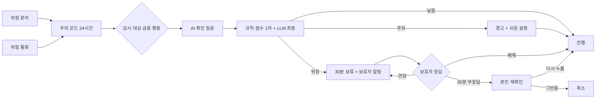
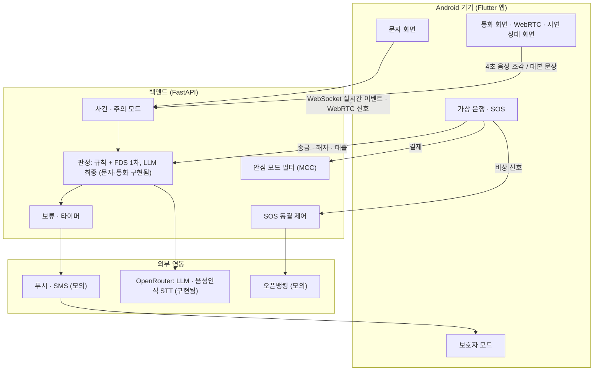

# 핑거벨 (FingerBell)

**사기 연락(문자·전화)과 그 뒤에 이어지는 금융 행동을 하나의 사건으로 묶어 탐지하고, 피해 직전의 거래를 30분 보류해 보호자와 연결하는 Android 시연용 앱**

2026 디지털새싹 문제해결 경진대회(CODE) 트랙 1 · 팀 핑거스냅 (한국게임과학고등학교)

[](https://github.com/daion8245/finance_tech/actions/workflows/ci.yml)


> 공항이 입구 보안검색대에서 한 번, 탑승구에서 한 번 더 확인하듯, 핑거벨은 연락 단계와 금융 행동 단계를 이어서 봅니다.

기획 전체는 [docs/Prescript/핑거벨_기획서.md](docs/Prescript/핑거벨_기획서.md)에 있습니다. AI 코딩 에이전트에게 그대로 줄 수 있는 구현 프롬프트 형태입니다.

## 문제

- 사기는 문자 → 전화 → 적금 해지·이체로 이어지는 흐름인데, 기존 보호 장치는 채널별로 따로 봅니다. 문자 필터는 문자만, 은행 거래 탐지는 거래만 봅니다.
- 각 단계만 떼어 보면 이상하지 않습니다. 적금 해지 자체는 정상 거래입니다.
- 어르신은 사기범의 "지금 당장" 압박 속에서 혼자 판단합니다.

대상은 디지털 취약계층 전반이고, 대표 사용자는 혼자 사는 70대 어르신입니다.

## 대표 시나리오

1. **기관 사칭 문자 수신**: 앱 안의 문자 화면에 사칭 문자가 옵니다. 경고가 붙고, 링크를 누르면 차단 화면이 뜹니다. 주의 모드(24시간)가 시작됩니다.
2. **문자에 적힌 번호로 통화**: 앱 안에서 상대 역할을 맡은 팀원과 음성 통화가 연결됩니다. 통화 분석이 사기 징후를 잡으면 큰 경고, 진동·경고음, 보호자 즉시 알림, [통화 끊기] 버튼이 나옵니다.
3. **통화 뒤 적금을 만기 전에 해지하려 함**: AI가 앞선 문자·통화에 맞춘 질문을 큰 버튼 객관식으로 묻습니다.
4. **종합 판정 '위험'**: 해지를 30분 보류하고 보호자에게 알립니다.
5. **보호자 확인**: 보호자가 위험 근거 요약을 보고 앱 안 통화로 어르신에게 연락한 뒤, 보류를 해제하거나 연장합니다.
6. **보호자가 답하지 않음**: 30분이 지나도 거래는 저절로 나가지 않습니다. 어르신이 설명을 다시 보고 한 번 더 눌러야 진행됩니다.



## 핵심 기능과 구현 상태

상태는 이 저장소의 코드 기준입니다.

| 기능 | 하는 일 | 상태 |
| :--- | :--- | :--- |
| **문자 감지** | 휴대폰 문자 앱을 재현한 화면에서 시연 문자의 내용과 링크를 분석합니다(규칙 1차 → OpenRouter LLM 최종). 위험하면 경고와 쉬운 설명을 붙이고 주의 모드를 시작하며 링크를 차단합니다. | 구현됨 (`backend/app/domain/sms.py` · `backend/app/integrations.py` · `feature_sms`) |
| **통화 감지** | 앱 안 인터넷 음성 통화(WebRTC)의 음성을 글자로 바꿔 실시간으로 분석하고(규칙 1차 → OpenRouter LLM 최종), 사기 징후가 잡히면 통화 중에 큰 경고·진동·경고음·`[통화 끊기]`를 띄우고 보호자에게 알립니다. 시연 상대 화면의 대본 문장 보내기도 지원합니다. | 구현됨 (`backend/app/domain/call.py` · `backend/app/integrations.py` · `feature_call`) |
| **주의 모드** | 위험 문자나 위험 통화가 감지되면 24시간 유지됩니다. 본인은 끌 수 없고 보호자는 끝낼 수 있습니다. | 구현됨 (`backend/app/service.py` · `feature_guardian`) |
| **확인 질문과 종합 판정** | 주의 모드 중 적금·예금 해지, 큰 금액 송금, 대출 한도 조회·신청을 시도하면 AI가 앞선 연락에 맞춘 질문을 하고, 규칙·점수 1차와 LLM 최종으로 낮음 / 주의 / 위험을 정합니다. | 구현됨 (`backend/app/domain/banking.py` · `backend/app/integrations.py` · `core_ui` · `feature_transfer`) |
| **거래 보류** | 위험 판정 거래(송금·적금 해지·대출 신청)를 30분 멈춥니다. 보호자는 해제·연장, 본인은 취소할 수 있고, 보호자 응답이 없으면 본인이 다시 확인해야 진행됩니다. | 구현됨 (`backend/app/service.py` · `feature_transfer` · `feature_guardian`) |
| **보호자 모드** | 위험 근거 요약(시간순), 보류 해제·연장, 앱 안 통화, 주의 모드 해제, 위험 기록(목록→상세), QR·코드 연결 및 동의, 가족 상태·한도·모드 관리. | 구현됨 (`backend/app/service.py` · `feature_guardian` · `packages/app/lib/views/settings_view.dart`) |
| **가상 은행** | 계좌 조회, 송금, 결제, 거래 내역, 적금·예금 만기 전 해지, 대출 한도 조회·신청(온라인 설명의무 7.2 반영). | 구현됨 (`backend/app/domain/banking.py` · `packages/app/lib/views/banking_sheets.dart`) |
| **위험 점수(AI FDS)** | 송금마다 설명 가능한 규칙과 Isolation Forest로 0~99점을 매깁니다. 종합 판정의 1차 단계입니다. | 구현됨 (`backend/app/domain/fds.py`) |
| **SOS 계좌 동결** | 휴대폰을 3초 동안 세게 흔들거나 SOS 버튼을 2초 누르면 모든 계좌의 출금이 24시간 멈추고 보호자에게 알립니다. | 구현됨 (`backend/app/service.py` `freeze()` · `feature_sos`) |
| **아이 모드와 안심 모드** | 등교·병원 모드의 업종(MCC) 화이트리스트로 결제를 제한하고, 수면 안심 시간(23:00~06:00)의 이체는 보호자 확인을 거칩니다. | 구현됨 (`backend/app/domain/catalog.py` · `feature_payment`) |
| **쉬운 화면과 접근성** | 홈 상단 쉬운 화면 토글·기기 저장·어르신 첫 실행 질문, 스크롤 없는 쉬운 화면 홈, `[사기 신고·도움]`, 설정 › 사용 방법 3장·불편한 점 보내기, 57dp 버튼·명도 대비 3:1 이상·색+글자+아이콘·SOS 탭 확인창·초점·음성 안내. | 구현됨 (`core_ui` · `core_shell` · `packages/app/lib/views/easy_home.dart` · `settings_sheets.dart`) |

### 위험 판정

단계는 낮음 / 주의 / 위험입니다.

| 조건 | 동작 |
| :--- | :--- |
| 낮음 | 그대로 진행 |
| 주의 | 경고와 쉬운 설명을 보여 주고, 본인이 확인하면 진행 |
| 위험 | 30분 보류 + 보호자 알림 |
| 보호자 확인 금액 이상이거나 수면 안심 시간인 송금 | 단계와 상관없이 30분 보류 + 보호자 알림 |

주의 모드 밖에서는 송금을 FDS 점수로 판정합니다. 60점 이상 위험이거나, 보호자 확인 금액(어르신 30만원, 아이 1만원) 이상이거나, 수면 안심 시간이면 30분 보류하고 보호자에게 알립니다. 30점 이상 주의는 경고와 쉬운 설명을 보여 주고 본인이 확인하면 진행합니다.

송금의 위험 점수(FDS)는 **설명 가능한 규칙**과 **비지도 학습 모델**을 합쳐 계산합니다. 이 부분은 구현되어 있습니다.

| 신호 | 기준 | 점수 |
| :--- | :--- | ---: |
| 신규 계좌 | 등록되지 않았고 최근 6개월 송금 이력이 없는 계좌 | +35 |
| 이상 금액 | 최근 3개월 평균 송금액의 300% 초과 | +30 |
| 분할 송금 | 10분 안에 이미 2번 이상 송금 시도 | +25 |
| 한도 초과 | 오늘 쓴 돈 + 이번 금액이 하루 한도 초과 | +20 |
| 심야 | 23:00~06:00 | +15 |
| 패턴 이상 | **Isolation Forest**가 사용자의 최근 6개월 출금(금액·시간대·신규 여부·연속 시도)과 다르다고 판단 | +5~15 |

기본 5점에 더해 60점 이상은 **위험**, 30점 이상은 **주의**입니다. 위험도는 항상 서버가 다시 계산하므로 앱이 점수를 조작할 수 없습니다.

## 지침 적용

화면에는 아래 세 지침의 원칙을 적용했습니다. 원칙별로 적용한 화면·확인 방법·상태(적용 / 일부 적용)는 [docs/Prescript/지침_적용표.md](docs/Prescript/지침_적용표.md)에, 기획 기준은 기획서 7절, 원문은 [docs/Prescript/예시/](docs/Prescript/예시/)에 있습니다.

- 「고령자 친화적 모바일 금융앱 구성지침」 (금융위원회·금융감독원·은행연합회, 2022.2.25.): 쉬운 화면, 쉬운 말, 진행단계 표시, 사기 신고 접근성
- 「온라인 설명의무 가이드라인」 (설명의무 가이드라인 상시개선 협의체, 2022.8.): 대출 신청과 적금 해지 화면의 중요사항 설명, 불이익 강조, 이해 확인
- KS X 3253:2016 「모바일 애플리케이션 콘텐츠 접근성 지침 2.0」: 대체 텍스트, 명도 대비, 누르기 영역 크기, 색에 의존하지 않는 표시

핑거벨은 가상 상품을 쓰는 시연 앱이라 세 지침의 원칙을 적용할 뿐이고, 인증이나 심사를 받은 것은 아닙니다.

## 시스템 구조



| 구성 요소 | 결정 | 상태 |
| :--- | :--- | :--- |
| 앱 | Flutter 모노레포(Pub Workspaces + Melos). 시연 대상은 Android | 구현됨 |
| 서버 | FastAPI + SQLite. 위험 판정, 타이머, 실시간 이벤트 | 구현됨 |
| 실시간 | `GET /api/v1/state` + `WS /api/v1/ws` (WebRTC `ready` → `offer` → `answer` → `ice` 신호 전달 포함) | 구현됨 |
| 통화 | WebRTC 직접 연결 (`flutter_webrtc`, `iceServers: []`, 음성 전용) + 4초 조각 녹음 (`record`) | 구현됨 (`feature_call`, 실기기 미확인) |
| 음성인식(STT) | 1순위 OpenRouter(`POST /api/v1/audio/transcriptions`), 2순위 기기 내 음성인식 | 1순위 OpenRouter 구현됨 (`backend/app/integrations.py`) · 2순위 기기 내 음성인식은 미구현 (1단계 스파이크 필요) |
| LLM | OpenRouter. 인터넷이나 키가 없으면 규칙·점수 판정만 | 문자·통화·확인 질문·사건 종합 판정 구현됨 (`backend/app/integrations.py`) |
| 외부 연동 | 오픈뱅킹·푸시·SMS 모의 어댑터 | 구현됨 |

### 통화·음성인식 방식의 가정과 실기기 미확인 항목

실기기가 없어 기획서 10절의 1단계(통화·음성인식 스파이크)를 건너뛰고 아래 가정을 확정해 구현했습니다. 아래 항목들은 **실기기에서 확인하지 못했습니다.**

- **WebRTC 연결 순서**: 받는 쪽이 `[전화 받기]`를 눌러 연결 준비를 마치면 `ready` 신호를 보내고, 발신 쪽은 `ready`를 받은 뒤 `offer`를 만들어 보내며, 이어서 `answer` → `ice` 순서로 교환합니다(받기 → `ready` → `offer` → `answer` → `ice`). 원격 설명(`setRemoteDescription`) 설정 전에 도착한 ICE 후보는 대기열에 모아 두었다가 설정 뒤에 반영하며, 화면에 연결 상태(`"음성 연결 중"` / `"음성 연결됨"` / `"음성을 연결하지 못했어요"`)를 표시합니다.
- **음성 수집 및 전사 가정**: 말하는 쪽 기기가 자기 마이크 소리를 **4초 조각(WAV)** 으로 녹음해 서버로 올리고(`POST /api/v1/calls/{call_id}/audio`), 서버가 OpenRouter 음성인식 게이트웨이로 글자로 바꿔 분석합니다. 녹음 회전 타이머와 업로드 대기를 분리해 조각 길이가 4초로 유지되게 합니다.
- **마이크 동시 사용 충돌 대비**: Android 실기기에서 WebRTC 통화(`flutter_webrtc`)와 조각 녹음(`record`)이 마이크를 동시에 쓰지 못할 수 있습니다. 그래서 **녹음이 실패해도 통화는 끊기지 않도록** 녹음 코드를 `packages/features/feature_call/lib/src/chunk_recorder.dart` 한 파일에 모으고, 실패하면 통화 화면에 `"음성 분석을 쓸 수 없어요"`를 글자로 보여 줍니다.
- **2순위 기기 내 음성인식**: 통화 중 동작 여부를 실기기에서 확인하지 못해 **미구현(1단계 스파이크 필요)** 상태입니다.
- **OpenRouter 실제 LLM·STT 호출**: 코드와 HTTP 조립·파싱·실패 대체 테스트(`MockTransport`)는 구현했지만, 실제 `OPENROUTER_API_KEY`를 넣은 실서버 호출 품질은 수동 평가(`backend/scripts/eval_llm.py`)로 확인이 필요합니다.
- **TalkBack · 실제 경고음 · 카메라 QR**: 시맨틱 트리와 `ToneGenerator` 채널 호출은 위젯 테스트로 확인했으나, 실제 기기에서의 TalkBack 읽기 순서·초점 이동, 실제 경고음 출력, 카메라 QR 스캔(`mobile_scanner`)은 실기기에서 확인하지 못했습니다.
- **시연 상대 화면의 대본 문장 보내기**: 음성인식이나 마이크 제약에 시연이 막히지 않도록 시연 상대 화면에서 대본 문장을 누르면 음성인식을 거치지 않고 글자 그대로 서버 통화 분석(`POST /api/v1/calls/{call_id}/transcript`)으로 들어갑니다. 화면에는 `"음성인식 없이 문장을 보냅니다"`라고 표시합니다.
- **새로 추가한 패키지 (`feature_call`)**:
  - `flutter_webrtc`: 같은 Wi-Fi 안의 기기끼리 외부 STUN·TURN 없이 음성 통화를 직접 연결하기 위해 추가했습니다.
  - `record`: 분석 대상 통화(어르신·아이 ↔ 시연 상대)에서 마이크 소리를 4초 단위 WAV 조각으로 녹음해 서버로 올리기 위해 추가했습니다.

- **새로 추가한 패키지 (`feature_guardian`)**:
  - `qr_flutter`: 보호자 기기에서 연결 코드 값을 QR 코드 이미지로 그려 보여 주기 위해 추가했습니다.
  - `mobile_scanner`: 어르신 기기에서 카메라로 보호자 QR 코드를 읽기 위해 추가했습니다(카메라를 쓸 수 없는 에뮬레이터를 위해 같은 코드 값을 직접 입력하는 경로도 함께 둡니다).

앱은 서버의 가족 상태(`GET /api/v1/state`)를 그리고, 상태가 바뀌면 WebSocket(`/api/v1/ws`) 이벤트를 받아 다시 불러옵니다. 그래서 **휴대폰 여러 대**(어르신 폰·보호자 폰)로도, 한 화면에서 사용자를 바꿔 가며도 같은 흐름을 시연할 수 있습니다.

외부 연동은 **모의 어댑터**입니다. 실제 API와 같은 형식의 호출 기록을 남기고(설정 › 서버 연동 기록), `backend/app/integrations.py`의 같은 메서드를 가진 클래스로 바꾸면 실제 연동이 됩니다.

## 저장소 구조

```
docs/Prescript/             기획서(AI 구현 프롬프트) · 지침 원문
backend/                    FastAPI 서버 · SQLite(기본)/PostgreSQL · AI FDS · 문자 판정 · 테스트
  app/domain/fds.py         규칙 + Isolation Forest 위험도
  app/domain/sms.py         문자 규칙 1차 판정 · 시연 문자 프리셋 · 가상 검증 모음
  app/domain/call.py        통화 규칙 1차 판정 · 시연 통화 대본(사기·정상) · 가상 검증 모음
  app/domain/banking.py     적금 만기 전 해지 계산 · 대출 상품/상환 계산 · 확인 질문 · 주의 모드 종합 판정 1차 규칙
  app/domain/catalog.py     안심 모드 · 업종(MCC) · 시연 가맹점
  app/service.py            사건·주의 모드 · 문자 수신/판정 · 통화 세션/분석 · 송금/해지/대출 판정·보류 · 결제 제어 · SOS 동결 · 타이머
  app/integrations.py       오픈뱅킹 · FCM · SMS (모의) · OpenRouter LLM · 음성인식(STT) 게이트웨이 (모의 + 실제)
packages/
  app/                      셸: 모바일(하단 메뉴) 레이아웃, 화면 연결
  core/
    core_api/               HTTP · WebSocket 클라이언트 (실시간 이벤트 + WebRTC 신호 전달)
    core_family/            가족 상태 모델 · 저장소 · FamilyCubit (서버와 실시간 동기화)
    core_shell/             지금 사용자·탭·화면 설정 · 피드백 요청 (ShellCubit)
    core_ui/                디자인 시스템 (파랑·빨강 토큰, 고대비, 공용 위젯)
    core_errors/            공통 Failure
  features/
    feature_sms/            휴대폰 문자 화면 재현 (대화 목록·말풍선·위험 경고·외부 링크 차단 화면·전화번호 발신 연결)
    feature_call/           휴대폰 통화 화면 재현 (WebRTC 음성 통화·4초 조각 녹음·실시간 경고·시연 상대 화면)
    feature_sos/            흔들기 감지 · SOS 버튼 · 동결 화면
    feature_transfer/       AI 안심 점검·주의 확인·거래 보류·재확인 대기를 거치는 송금 시트
    feature_payment/        안심 모드를 따르는 결제 시트
    feature_guardian/       위험 근거 요약 · 위험 기록 · QR/코드 연결 및 동의 · 보류 해제·연장 · 주의 모드 해제 · 가족 통화 · 가족 관리
```

기능 패키지는 서로 의존하지 않고 `core_*`에만 의존합니다. 기능끼리는 `app`에서만 연결합니다.

## 실행하기 (Windows)

필요한 것: [Flutter](https://docs.flutter.dev/get-started/install), Python 3.11 이상(또는 [uv](https://docs.astral.sh/uv/)), Android SDK.

### 1. 백엔드

```powershell
.\run-backend.ps1
```

처음 실행하면 `backend/.venv`를 만들고 패키지를 설치합니다. API 문서는 <http://127.0.0.1:8765/docs> 입니다. `-Reset`을 붙이면 시연 데이터를 처음 상태로 되돌립니다.

### 2. Android

```powershell
.\run-android.ps1
```

에뮬레이터를 켜고 `adb reverse tcp:8765 tcp:8765`로 기기의 `127.0.0.1:8765`를 이 PC의 백엔드에 연결한 뒤 앱을 실행합니다. USB로 연결한 실제 휴대폰도 `-Device <기기 ID>`로 같게 쓰면 됩니다.

IntelliJ / Cursor / VS Code에는 **FingerBell (Android)** 실행 구성이 있습니다.

자세한 실행 옵션은 [RUN_LOCAL.ko.md](RUN_LOCAL.ko.md)에 있습니다.

## 지금 시연할 수 있는 시나리오

설정 탭의 **바로 시연해 보기**에서 바로 시작할 수 있습니다.

1. **사칭 문자 받기**: 어르신 문자 화면에 금융감독원 사칭 문자가 도착 → 말풍선에 위험 경고와 쉬운 설명 표시, 24시간 주의 모드 시작(어르신 홈·보호자 화면에 표시) → 문자 속 가짜 링크를 누르면 외부로 열지 않고 `"이 링크를 열지 않았어요"` 차단 화면 표시 → 문자 속 전화번호(`02-0000-1332`)를 누르면 통화 화면(시연 상대에게 발신)으로 연결.
2. **정상 문자 받기**: 택배·가족·은행 알림 등 정상 문자 도착 → 경고 없이 일반 말풍선으로 표시되고 주의 모드는 켜지지 않음.
3. **시연 상대 화면 열기**: 은행 기능이 없는 시연 전용 화면 → 사칭·정상 문자 보내기, 걸려 온 전화 받기, 사기 대본(금융감독원 사칭 → 적금 해지 요구)·정상 대본(가족 안부) 표시 및 대본 문장 보내기(`"음성인식 없이 문장을 보냅니다"`) → 사기 문장을 보내면 어르신 통화 화면에 큰 경고·쉬운 설명 한 줄·진동·경고음·`[통화 끊기]` 표시, 보호자 즉시 알림, 주의 모드 시작(또는 연장).
4. **흔들어서 SOS 동결**: 어르신 화면이 흔들리고 → 전 계좌 출금 동결 → 빨간 동결 화면과 24시간 카운트다운 → 보호자 화면에 "동결 중".
5. **낯선 계좌로 50만원 송금**: AI 안심 점검이 위험(80점대)으로 판정 → 거래 30분 보류 + 보호자 알림 → 보호자가 해제(즉시 실행)하거나 연장(30분 추가), 또는 30분 동안 응답이 없으면 어르신 본인 재확인 대기(`[그래도 진행]` / `[그만두기]` / `[보호자에게 전화]`).
6. **등교 모드에서 게임 결제**: 게임 업종(MCC 5816)은 등교 모드 화이트리스트에 없어 차단 → 보호자에게 요청 → 승인되면 결제.
7. **처음 상태로 되돌리기**: 모든 시연 데이터를 초기화해 처음 상태부터 다시 시연.

**두 기기·세 기기 시연**: 어르신·보호자·시연 상대 기기로 역할을 나눈 뒤, 사칭 문자의 번호를 눌러 발신 → 시연 상대 화면에서 전화 받기 → 대본의 사기 문장 보내기 → 어르신 통화 화면 경고 및 보호자 즉시 알림 흐름을 끝까지 시연할 수 있습니다.

## 주요 API (지금 구현된 것)

| 메서드 · 경로 | 설명 |
| :--- | :--- |
| `POST /api/v1/sms/receive` (`GET /api/v1/sms`) | 시연 문자 수신 및 위험 판정(규칙 1차 → LLM 최종). 위험이면 24시간 주의 모드 시작 및 사건 요약 기록 / 발신 번호별 대화·문자 목록 조회 |
| `POST /api/v1/calls/start` · `/calls/{id}/answer` · `/calls/{id}/end` (`GET /api/v1/calls`, `/calls/scripts`) | 통화 발신·수신·종료 및 시연 대본 조회. 어르신·아이 ↔ 시연 상대 통화만 분석 대상으로 표시하고 보호자 ↔ 가족 통화는 분석하지 않음 |
| `POST /api/v1/calls/{id}/audio` · `/calls/{id}/transcript` · `/calls/{id}/signal` | 4초 음성 조각 업로드(음성인식 → 통화 분석) / 대본 문장 보내기(음성인식 없이 통화 분석) / WebRTC 연결 신호 전달. 원문은 저장하지 않고 사기 징후 감지 시 실시간 경고 이벤트·보호자 알림·주의 모드 시작·사건 요약 기록 |
| `POST /api/v1/security/sos-freeze` (`/api/v1/emergency/freeze`) | SOS 동결. `user_id`, `trigger_type`(SHAKE_MOTION / LONG_PRESS / GUARDIAN_REMOTE), `sensor_intensity` → `status`, `frozen_accounts_count`, `freeze_expires_at`, `guardian_notified` |
| `POST /api/v1/security/caution-mode/release` | 보호자의 가족 주의 모드(24시간) 해제 |
| `POST /api/v1/transaction/assess` | 송금 전 AI 안심 점검 (저장하지 않음) |
| `POST /api/v1/transaction/transfer` | 송금. 낮음이면 바로 진행, 주의면 본인 확인(`confirmed=true`) 후 진행, 위험·확인 금액 이상·수면 안심 시간이면 30분 보류 |
| `POST /api/v1/transaction/request-approval` | 이상 거래 보류 요청 → `transaction_id`, `status: PENDING_APPROVAL`, `hold_seconds: 1800` |
| `POST /api/v1/transaction/cancel` · `/transaction/reconfirm` · `/transaction/extend` | 보류 중 본인 취소 / 30분 무응답 뒤 본인 재확인(`[그래도 진행]` / `[그만두기]`) / 보호자 보류 30분 연장 |
| `POST /api/v1/banking/question` · `/banking/savings/cancel` | 주의 모드 확인 질문 생성 · 적금 만기 전 해지(주의 모드 중 질문·종합 판정 → 위험 시 30분 보류, 주의 모드 밖 즉시 해지) |
| `GET /api/v1/banking/loan/product` · `POST /banking/loan/quote` · `/banking/loan/limit` · `/banking/loan/apply` | 대출 상품 조회 · 월 납입액/총 이자 계산 · 한도 조회(보류 없이 위험 시 경고+보호자 알림) · 대출 신청(위험 시 30분 보류) |
| `POST /api/v1/guardian/callback-decision` | 보호자 보류 해제·연장 및 요청 승인·거절. `transaction_id`, `guardian_id`, `decision`(RELEASE / EXTEND / APPROVE / REJECT), `reason` |
| `POST /api/v1/payments/pay` · `/payments/request-approval` | 안심 모드를 따르는 결제 / 막힌 결제의 보호자 요청 |
| `POST /api/v1/modes` · `/guardian/limits` · `/guardian/sleep-guard` | 안심 모드 · 하루 한도 · 수면 안심 모드 |
| `POST /api/v1/guardian/pairing-code` · `/pairing/connect` | 보호자 연결 QR/6자리 코드 발급(유효 시간 제한) · 코드와 어르신 동의 제출(연결·동의 시각 기록) |
| `POST /api/v1/feedback` | 설정 › 불편한 점 보내기 의견 저장(`user_feedback` 테이블) |
| `GET /api/v1/state` · `WS /api/v1/ws` | 가족 전체 상태(문자·통화·주의 모드·보류·사건 포함) · 실시간 이벤트 및 WebRTC 신호 전달 |

전체 목록과 요청 형식은 실행 중인 서버의 `/docs`(Swagger)에 있습니다.

## 서버 설정 (환경변수)

| 이름 | 기본값 | 설명 |
| :--- | :--- | :--- |
| `OPENROUTER_API_KEY` | 빈 값 (모의 동작) | OpenRouter API 비밀키. 설정하지 않으면 모의 LLM·음성인식 게이트웨이로 뜨며 규칙 판정만으로 동작합니다 |
| `FINGERBELL_LLM_MODEL` | `anthropic/claude-haiku-5.5` | OpenRouter 채팅 완성 모델 (다른 후보: `google/gemini-3.8-flash`, `upstage/solar-mini4`. 최종 선택은 사람이 정합니다) |
| `FINGERBELL_STT_MODEL` | `openai/whisper-large-v3` | OpenRouter 음성인식 모델 (다른 후보: `microsoft/mai-transcribe-2`, `openai/whisper-1`. 최종 선택은 사람이 정합니다) |
| `FINGERBELL_DATABASE_URL` | `sqlite:///backend/fingerbell.db` | PostgreSQL은 `postgresql+psycopg://...` (`psycopg[binary]` 설치) |
| `FINGERBELL_HOLD_SECONDS` | `1800` | 거래 보류 유지 시간(초, 기본 30분) |
| `FINGERBELL_RECONFIRM_SECONDS` | `86400` | 보류 후 본인 재확인 대기 만료 시간(초, 기본 24시간) |
| `FINGERBELL_APPROVAL_TIMEOUT` | `180` | 결제·모드 완화 요청의 보호자 승인 대기 시간(초, 기본 3분) |
| `FINGERBELL_CAUTION_MODE_HOURS` | `24` | 주의 모드 유지 시간(시간) |
| `FINGERBELL_FREEZE_HOURS` | `24` | SOS 동결 유지 시간(시간) |
| `FINGERBELL_PAIRING_CODE_SECONDS` | `300` | 보호자 연결 QR/코드 유효 시간(초, 기본 5분) |

앱의 서버 주소는 `--dart-define=FINGERBELL_API_URL=http://<주소>:8765`로 바꿉니다.

## 테스트

```powershell
# 백엔드 (SOS · FDS · 주의 모드/사건 · 보류/재확인 · 안심 모드 · 실시간 · 대표 시나리오 종단 테스트)
cd backend; .\.venv\Scripts\python.exe -m pytest

# 수동 OpenRouter LLM 평가 (OPENROUTER_API_KEY가 있을 때 사람이 실행, 없으면 안내 후 종료)
cd backend; .\.venv\Scripts\python.exe scripts/eval_llm.py

# Flutter (패키지마다)
melos bootstrap
melos run analyze
melos run test
```

## 사람이 정할 항목 (기획서 11절)

아래 결정 사항은 코드에 기본값·가상 규칙으로만 두었고 최종 결정은 사람이 정합니다.

- OpenRouter에서 쓸 LLM과 음성인식(STT) 모델
- 서비스 이름 (지금은 팀 이름인 핑거벨을 사용)
- 감시 우려(개인정보) 대응 원칙 (기본값은 원문 비저장·요약 기록과 보호자 연결 동의 화면)
- 탐지 정확도와 오탐의 목표 수치 (현재 규칙 단계 검사는 `pytest`, LLM 평가는 `backend/scripts/eval_llm.py`로 수치 출력)
- 1단계 통화·음성인식 실기기 스파이크 실패 시 대안 방향 (현재 2순위 기기 내 STT는 미구현)

## 알아 둘 점

- 시연용 가상 데이터를 쓰며 실제 은행·금융 서비스와 연결되지 않습니다. 문자·계좌·전화번호(`02-0000-xxxx`, `010-0000-xxxx`)와 링크(`.invalid`)는 모두 존재하지 않는 가짜입니다.
- 흔들기 감지는 휴대폰에서만 동작합니다. PC에서는 "흔들어서 SOS 동결" 시나리오 버튼으로 시연하세요.
- 한글 글꼴 **Noto Sans KR**(가변 글꼴, SIL Open Font License 1.1)을 앱에 넣었습니다(`packages/core/core_ui/assets/fonts/`, 라이선스는 같은 폴더의 `OFL.txt`이고 앱의 설정 › 오픈소스 라이선스에서도 볼 수 있습니다).
- 이 저장소는 오픈소스 학습용 은행 앱 [Tristan-2021/finance_tech](https://github.com/Tristan-2021/finance_tech)의 모노레포 구조를 바탕으로 핑거벨에 맞게 다시 만들었습니다.
