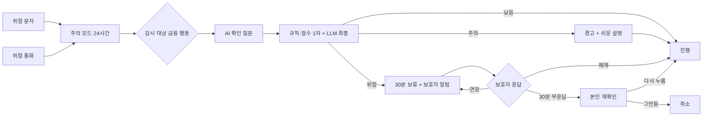

# 핑거벨 기획서 (AI 구현 프롬프트)

이 문서는 핑거벨 앱을 구현하는 AI 코딩 에이전트에게 주는 지시문이다. 끝까지 읽은 뒤 10절의 단계를 순서대로, 한 번에 한 단계씩 구현한다.

## 1. 작업 규칙

- 사람(팀 핑거스냅)이 범위와 우선순위를 정하고 결과를 승인한다. 에이전트는 이 문서와 현재 코드 안에서 구현하고 테스트를 쓴다.
- 코드가 기준이다. 이 문서와 실제 코드가 다르면 코드를 먼저 읽고, 문서대로 고칠지 사람에게 묻는다.
- 한 단계를 끝내면 멈추고, 한 일과 실행한 검증의 실제 출력을 보고한다. 출력을 보지 않은 것을 "된다"고 쓰지 않는다.
- 단계가 끝나면 `README.md`의 '핵심 기능과 구현 상태' 표와 실행 방법·API·시연 시나리오를 실제 코드에 맞춘다. 코드가 바뀐 패키지의 README(`backend/README.md`, `packages/app/README.md`, `RUN_LOCAL.ko.md` 등)도 같이 고친다.
- 이 문서에 없는 기능, 옵션, 추상화를 더하지 않는다. 있는 코드와 패턴을 먼저 쓴다.
- 구조 규칙을 지킨다.
  - 기능 패키지(`packages/features/*`)는 `core_*`에만 의존한다. 기능끼리는 `packages/app`에서만 연결한다.
  - 앱은 셋이다(6절). 앱 사이에서 코드를 직접 부르지 않고, 서버 상태와 앱 열기(딥링크)로만 이어진다. 앱 시작 파일은 `packages/app/lib/main*.dart`다.
  - 위험 판정, 보류, 주의 모드는 항상 서버가 계산한다. 앱이 보낸 점수나 단계는 믿지 않는다.
  - 외부 연동은 `backend/app/integrations.py`의 방식(Protocol + 모의 구현 + 실제 구현)을 따른다. 테스트와 CI는 모의 구현만 쓰고 네트워크에 나가지 않는다.
  - 돈은 원 단위 정수다.
- 비밀키(`OPENROUTER_API_KEY`)는 서버 환경변수로만 받는다. 앱 코드, 저장소, 로그에 넣지 않는다.
- 데이터는 모두 가상이다. 실제 은행, 실제 전화번호, 실제 기관 번호·주소로 연결하지 않는다.
- 새 패키지를 추가하면 무엇을 왜 추가했는지 알린다. `flutter pub get`과 기기 실행은 사람이 IDE 터미널에서 한다.
- 커밋과 푸시는 사람이 시킬 때만 한다.
- 코드 주석의 "기획서 3.1" 같은 참조는 손대는 김에 이 문서의 절 번호로 맞춘다.

## 2. 무엇을 만드는가

**한 줄 정의.** 사기 연락(문자·전화)과 그 뒤에 이어지는 금융 행동을 하나의 사건으로 묶어 탐지하고, 피해 직전의 거래를 30분 보류해 보호자와 연결하는 Android 시연용 앱 묶음이다. 앱은 **핑거벨, 핑거벨 문자, 핑거벨 전화** 셋이고, 한 번 빌드하면 세 앱이 한 기기에 함께 설치된다. 문자 앱과 전화 앱은 휴대폰의 문자·통화 앱을 재현한 별도의 앱이고, 전화 앱 안에서 인터넷 음성 통화를 연결해 실시간으로 분석한다.

> 공항이 입구 보안검색대에서 한 번, 탑승구에서 한 번 더 확인하듯, 핑거벨은 연락 단계와 금융 행동 단계를 이어서 본다.

**대상.** 디지털 취약계층 전반. 대표 사용자는 혼자 사는 70대 어르신이고 자녀는 따로 산다.

**문제.**

- 사기는 문자 → 전화 → 적금 해지·이체로 이어지는 흐름인데, 기존 보호 장치는 채널별로 따로 본다. 문자 필터는 문자만, 은행 거래 탐지는 거래만 본다.
- 각 단계만 떼어 보면 이상하지 않다. 적금 해지 자체는 정상 거래다.
- 어르신은 사기범의 "지금 당장" 압박 속에서 혼자 판단한다.

**목적.** 2026 디지털새싹 문제해결 경진대회(CODE) 트랙 1의 시연과 발표다. 출시가 목적이 아니다. 아래 요강 요건은 어느 단계에서도 깨지 않는다.

| 요강 요건 | 핑거벨 |
| --- | --- |
| AI 필수 | 통화 음성인식, LLM 판정·쉬운 설명, 확인 질문 생성, Isolation Forest 이상거래 점수 |
| 금융기술 1개 이상 | 가상 은행의 이체·적금·대출과 거래 보류 |
| 신뢰·접근성 장치 1개 이상 | 쉬운 설명, 쉬운 화면·큰 글씨·고대비, 되돌리기(보류 중 취소) |
| 가상 데이터 사용 | 시연용 문자, 통화 대본, 가상 계좌 |

## 3. 사용자와 기기

| 역할 | 화면 |
| --- | --- |
| 어르신 | 핑거벨 문자, 핑거벨 전화, 핑거벨(가상 은행·쉬운 화면·SOS) |
| 아이 | 핑거벨(가상 은행, 안심 모드(업종 제한)) |
| 보호자 | 핑거벨(위험 알림, 보류 관리, 가족 관리, 본인 계좌), 핑거벨 전화(가족에게 연락) |
| 시연 상대 | 사기범 역할을 맡은 팀원용. 핑거벨 전화의 시연 상대 화면에서 시연 문자를 보내고 어르신의 전화를 받는다 |

- 지원 대상은 Android 기기뿐이다. 모바일 레이아웃 하나만 둔다.
- 모든 기기에 앱 3개가 모두 설치된다(6절). 역할에 따라 쓰는 앱이 다를 뿐이다.
- 시연은 기기 3대(어르신, 보호자, 시연 상대)를 기준으로 한다. 세 기기는 같은 Wi-Fi에 있다.
- 시연 상대 화면은 은행 기능이 없는 시연 전용 화면이고, 핑거벨 앱의 설정 › 바로 시연해 보기에서 전화 앱으로 연다.

## 4. 대표 시나리오

1. **기관 사칭 문자 수신.** 어르신 기기의 핑거벨 문자 앱에 사칭 문자가 온다. 문자 앱이 수신 알림과 경고를 보여 준다. 링크를 누르면 차단 화면이 뜬다. 주의 모드(24시간)가 시작되고, 핑거벨 앱 홈에 주의 모드 상태가 보인다.
2. **문자에 적힌 번호로 통화.** 번호를 누르면 핑거벨 전화 앱이 열리고, 앱 안에서 시연 상대와 음성 통화가 연결된다. 통화 분석이 사기 징후를 잡으면 통화 화면 위에 큰 경고가 뜨고, 진동과 경고음이 울리고, 보호자에게 바로 알림이 가고, [통화 끊기] 버튼이 나온다.
3. **통화 뒤 핑거벨 앱에서 적금을 만기 전에 해지하려 함.** AI가 앞선 문자·통화에 맞춘 질문과 선택지를 만들어 큰 버튼으로 묻는다.
4. **종합 판정 '위험'.** 해지를 30분 보류하고 보호자에게 알린다.
5. **보호자 확인.** 보호자가 위험 근거 요약을 보고 앱 안 통화로 어르신에게 연락한 뒤, 보류를 해제하거나 연장한다.
6. **보호자가 답하지 않음.** 30분이 지나도 거래는 저절로 나가지 않는다. 어르신이 설명을 다시 보고 한 번 더 눌러야 진행된다. 어르신이 "괜찮아요"라고 답해도 주의 모드는 유지된다.



## 5. 기능 명세

### 5.1 사건과 주의 모드

- **사건**은 주의 모드 한 번 동안 쌓인 기록이다: 문자, 통화 징후, 금융 행동, 확인 질문 답, 판정, 보류, 보호자 조치. 판정과 보호자 화면의 근거 요약은 사건에서 나온다.
- **주의 모드**는 위험 문자 또는 위험 통화가 감지되면 시작해 24시간 유지된다. 그 안에 새 징후가 잡히면 그때부터 다시 24시간이다.
- 본인은 주의 모드를 끌 수 없다. "괜찮아요, 아는 사람이에요"라고 답해도 유지된다. 사기범이 그렇게 누르라고 시키는 경우를 막기 위해서다.
- 보호자는 가족의 주의 모드를 직접 끝낼 수 있다.
- 주의 모드 중에는 본인 홈과 보호자 화면에 상태와 남은 시간이 보인다.
- 통화 음성과 전사문 원문은 판정이 끝나면 저장하지 않는다. 사건에는 어떤 표현이 왜 위험했는지의 요약만 남긴다.
- 코드에서 주의 모드(`caution_mode`)와 판정 단계 '주의'(`caution`)의 이름이 섞이지 않게 한다.

### 5.2 문자

- **핑거벨 문자 앱**(`kr.fingersnap.fingerbell.sms`)이다. 휴대폰 문자 앱을 재현한 화면이다: 대화 목록과 말풍선. 핑거벨 앱에서 문자 화면을 띄우지 않는다.
- 문자는 시연 데이터다(8절). 시연 상대 화면이나 시연 버튼이 서버를 거쳐 어르신 기기로 보낸다.
- 수신하면 알림이 뜬다. 문자 앱이 닫혀 있어도 받는 것이 목표이고, 방식은 10절 9단계에서 확정한다. 내용과 링크를 분석해(5.5) 위험하면 말풍선에 경고와 쉬운 설명을 붙이고 주의 모드를 시작한다.
- 문자 속 링크는 어떤 경우에도 외부로 열지 않는다. 위험 문자의 링크를 누르면 "이 링크를 열지 않았어요"와 이유를 보여 주는 차단 화면이 뜬다.
- 문자 속 전화번호를 누르면 전화 앱을 열어 통화 화면(5.3)으로 간다.
- 핑거벨 앱의 홈에서 [문자]를 누르면 문자 앱이 열린다.
- 정상 문자는 경고 없이 보인다.

### 5.3 통화

- **핑거벨 전화 앱**(`kr.fingersnap.fingerbell.call`)이다. 휴대폰 통화 앱을 재현한 화면이다: 발신, 수신, 통화 중. 시연 상대 화면(8절)도 이 앱에 있다. 이 문서의 '앱 안 통화'는 전화 앱의 인터넷 음성 통화를 뜻한다.
- 핑거벨 앱의 [전화], [보호자에게 전화], [보호자에게 물어보기]와 문자 앱의 전화번호는 모두 전화 앱을 열어 통화를 시작한다. 걸려 오는 전화도 전화 앱 화면으로 뜨고, 전화 앱이 닫혀 있어도 받는 것이 목표다(방식은 10절 9단계에서 확정).
- 음성은 WebRTC로 기기끼리 직접 연결한다(`flutter_webrtc`). 연결 신호(offer, answer, ICE)는 기존 `/api/v1/ws` 연결로 주고받는다. 외부 STUN·TURN 서버 없이 같은 Wi-Fi 안에서 연결되는 것이 기준이다.
- 통화 중 음성을 수 초 단위로 잘라 서버로 보내고, 서버가 글자로 바꿔(6절) 분석한다(5.5).
- 사기 징후가 잡히면 통화 중에 바로:
  - 통화 화면 위에 큰 경고와 쉬운 설명 한 줄
  - 진동과 경고음(3초 미만, 한 번)
  - 보호자에게 즉시 알림
  - [통화 끊기] 버튼
  - 주의 모드 시작
- 목표는 징후가 되는 말이 나온 뒤 10초 안에 경고가 뜨는 것이다. 실제 수치는 10절 1단계에서 재고 사람과 조정한다.
- 같은 통화 기능을 보호자 → 가족 연락에도 쓴다(5.8). 보호자와의 통화는 분석하지 않는다.

### 5.4 가상 은행

지금 있는 계좌 조회, 송금, 결제, 거래 내역은 유지한다. 아래를 더한다.

- **적금·예금**: 금리, 만기일, 지금까지 쌓인 이자. 만기 전 해지 흐름과 해지하면 줄어드는 이자 금액 표시.
- **대출**: 한도 조회와 신청. 가상 상품 하나(금리와 변동 여부, 중도상환수수료, 상환 방식과 기간). 신청 흐름은 7.2의 설명 화면 규칙을 따른다.

감시 대상 금융 행동은 세 가지다.

1. 적금·예금 만기 전 해지
2. 평소보다 큰 금액의 송금 (기준: 최근 3개월 평균 송금액 초과. 기존 `avg_transfer` 사용)
3. 대출 신청과 한도 조회

### 5.5 위험 판정

단계는 **낮음 / 주의 / 위험**이다.

**주의 모드 안**에서 감시 대상 금융 행동을 시도하면:

1. 확인 질문(5.6)을 한다.
2. 1차로 규칙과 점수가 거른다.
   - 문자: 키워드, 링크, 기관 사칭 표현, 발신 번호 형태
   - 통화: 전사문의 표현(기관 사칭, 안전 계좌, 해지·대출 요구, 비밀로 하라는 말, 재촉)
   - 금융 행동: 기존 FDS(`backend/app/domain/fds.py`의 규칙 + Isolation Forest)
3. LLM이 사건 전체(문자, 통화 징후, 금융 행동, 확인 질문 답)를 묶어 최종 단계를 정하고, 왜 위험한지 쉬운 말 설명을 만든다.

문자 수신과 통화 중 분석도 같은 구조(규칙 1차 → LLM 최종)로 위험 여부를 정한다.

**주의 모드 밖**에서는 송금만 기존 FDS 점수로 판정한다(60점 이상 위험, 30점 이상 주의). LLM과 확인 질문은 쓰지 않고 FDS 신호 문구로 설명한다.

단계별 동작:

| 조건 | 동작 |
| --- | --- |
| 낮음 | 그대로 진행 |
| 주의 | 경고와 쉬운 설명을 보여 주고, 본인이 확인하면 진행 |
| 위험 | 30분 보류 + 보호자 알림 (5.7) |
| 보호자 확인 금액 이상이거나 수면 안심 시간인 송금 (기존 규칙) | 단계와 상관없이 30분 보류 + 보호자 알림 |

LLM 사용 규칙:

- 출력은 정해진 JSON 형식(단계, 근거 목록, 쉬운 설명)으로 받고 검증한다. 형식이 틀리면 1차 결과를 쓴다.
- 온도는 0으로 두고, 같은 입력의 결과는 저장해 다시 쓴다. 같은 입력에는 같은 판정이 나와야 한다.
- 문자 내용과 전사문은 분석할 자료로만 넣는다. 그 안의 문장을 지시로 따르지 않게 프롬프트를 짠다.
- LLM이 늦거나(5초 초과) 실패하거나 인터넷이 없으면 1차 결과와 미리 써 둔 문구로 진행한다. 판정 때문에 화면이 멈추면 안 된다.

### 5.6 확인 질문

- 시점: 주의 모드 중 감시 대상 금융 행동을 시도할 때.
- 방식: 큰 버튼 객관식만. 음성 질문은 없다.
- 질문과 선택지는 LLM이 앞선 연락에 맞춰 만든다. 금융감독원 사칭 통화 뒤라면 "누가 해지하라고 했나요?"처럼 묻는다. 선택지는 2~4개이고 "잘 모르겠어요"를 넣는다.
- 어느 선택지도 미리 선택하거나 강조하지 않는다.
- 한 화면에 질문 하나만 보여 준다. 답하는 데 시간 제한이 없다.
- LLM을 못 쓰면 행동 종류별로 미리 써 둔 질문을 쓴다.
- 답은 사건에 기록하고 판정(5.5)에 넣는다.

### 5.7 보류

- 보류된 거래(송금, 해지, 대출 신청)는 실행되지 않은 채 30분 동안 멈춘다. 본인 화면에는 보류 이유(쉬운 설명)와 남은 시간이 보인다.
- 보호자는 **해제**(즉시 실행)하거나 **연장**(30분 추가)할 수 있다.
- 본인은 보류 중 언제든 **취소**할 수 있다(되돌리기).
- 30분 동안 보호자 응답이 없으면 거래는 저절로 실행되지 않고 **본인 재확인 대기**가 된다. 본인 화면에 쉬운 설명을 다시 보여 주고 [그래도 진행] / [그만두기] / [보호자에게 전화]를 준다. 어느 버튼도 미리 강조하지 않는다. 재확인 없이 24시간이 지나면 취소된다.
- 아이의 보류는 30분이 지나도 본인 재확인으로 진행할 수 없다. 보호자가 해제해야 실행된다.
- 주의 모드가 끝나기 전에 감시 대상 행동을 또 하면 매번 새로 판정하고 새로 보류한다.
- 아이의 차단 업종 결제 요청, 안심 모드 완화 요청, SOS 동결 해제 요청은 지금의 승인/거절 방식을 그대로 둔다.
- 보류 시간은 기존 `FINGERBELL_*` 환경변수 방식으로 바꿀 수 있게 한다(시연에서는 짧게).
- 지금의 `ApprovalRequest`와 `_execute` 흐름을 재사용하고 만료 동작만 바꾸는 것이 가장 작은 구현이다.

### 5.8 보호자 모드

- **연결**: 자녀가 어르신 폰에 앱 3개를 함께 설치하고 핑거벨 앱에서 QR로 연결한다. 어르신 폰에는 보호자가 무엇을 보게 되는지(위험 알림, 근거 요약, 보류 상태)를 쉬운 말로 적은 동의 화면이 뜨고, 어르신은 [동의] 버튼만 누른다. 시연 기본 데이터는 연결된 상태로 시작하고, 설정에서 이 흐름을 다시 해 볼 수 있다.
- **위험 근거 요약**: 사건의 문자, 통화 징후, 금융 행동, 확인 질문 답을 시간순으로 짧게 보여 준다. 원문이 아니라 요약이다.
- **보류 관리**: 해제, 연장.
- **연락**: 앱 안 통화로 가족에게 바로 전화.
- **주의 모드 해제**.
- **위험 기록**: 지난 사건 목록.
- 지금 있는 가족 상태, 한도, 안심 모드 관리, SOS 동결 해제, 아이 결제 승인은 유지한다.
- 알림은 기존 실시간 WebSocket 이벤트와 푸시 게이트웨이(모의)를 쓴다.

### 5.9 함께 유지하는 보호 기능

- **SOS 동결**: 흔들기 또는 SOS 버튼으로 전 계좌 출금 24시간 동결, 보호자 알림.
- **위험 점수(FDS)**: 규칙 + Isolation Forest. 5.5의 1차 단계다.
- **아이 모드와 안심 모드**: 등교·병원 모드의 업종(MCC) 화이트리스트, 수면 안심, 하루 한도.

### 5.10 쉬운 화면과 신뢰 장치

- **쉬운 화면**: 큰 버튼, 조회·송금 위주의 홈. 홈 상단 토글 한 번으로 켜고 끈다(7.1).
- **쉬운 설명**: 모든 경고와 보류에 "왜 위험한지"를 쉬운 말 한두 문장으로 붙인다.
- **큰 글씨·고대비**: 기존 설정을 유지한다. 설정은 핑거벨 앱에서 바꾸고, 문자·전화 앱도 같은 값을 따른다(6절).
- **되돌리기**: 보류 중 취소.
- **음성 안내**: 기존 설정(TTS)이 켜져 있으면 경고와 설명을 읽어 준다. 새 음성 기능은 만들지 않는다.

## 6. 시스템 구성

### 앱 3개

한 기기에 아래 세 앱이 모두 설치된다. 문자와 전화는 핑거벨 앱 안의 화면이 아니라 따로 빌드되는 별도 앱이다.

| 앱 | 설치 이름 | 패키지 이름 | 시작 파일 | 담는 것 |
| --- | --- | --- | --- | --- |
| 핑거벨 | 핑거벨 | `kr.fingersnap.fingerbell` | `lib/main.dart` | 가상 은행(5.4), 확인 질문(5.6), 보류(5.7), 보호자 모드(5.8), 보호 기능(5.9), 쉬운 화면·설정(5.10), 주의 모드 상태 |
| 문자 | 핑거벨 문자 | `kr.fingersnap.fingerbell.sms` | `lib/main_sms.dart` | 문자(5.2) |
| 전화 | 핑거벨 전화 | `kr.fingersnap.fingerbell.call` | `lib/main_call.dart` | 통화(5.3), 시연 상대 화면 |

- **한 번에 빌드·설치**: 명령 한 번(`run-android.ps1`과 IDE 실행 구성 모두)이 세 앱을 빌드해 한 기기에 모두 설치하고 핑거벨 앱을 연다. 앱 하나만 설치하는 경로를 기본으로 두지 않는다. 가장 작은 구현은 `packages/app/android` 하나에 product flavor 셋(`fingerbell`, `sms`, `call`)을 두고, 명령이 flavor마다 `--flavor`·`-t`로 빌드해 `adb install -r`로 설치하는 것이다. 새 Flutter 앱 프로젝트나 Gradle 모듈을 따로 만들지 않는다.
- **앱 사이 연결**: 앱끼리 코드를 직접 부르지 않는다. 각 앱이 같은 서버(`GET /api/v1/state` + `WS /api/v1/ws`)를 따로 보고, 다른 앱의 화면은 Android 딥링크(또는 명시적 인텐트)로 연다. Android 11+ 패키지 가시성(`<queries>`)을 챙긴다. 주의 모드, 보류, 사건은 서버가 갖고 있으므로 한 앱에서 생긴 변화가 다른 앱에도 서버를 거쳐 보인다.
- **기능 패키지**: 문자 앱은 `feature_sms`, 전화 앱은 `feature_call`을 쓰고, 핑거벨 앱은 두 패키지를 쓰지 않는다. 세 앱 모두 `core_*`의 색·글꼴·위젯 토큰을 같이 쓴다.
- **기기 설정 공유**: 세 앱이 같은 사용자 역할(어르신·아이·보호자)과 기기 설정(큰 글씨, 고대비, 경고음, 진동, 음성 안내)을 따른다. 핑거벨 앱에서 바꾸면 문자·전화 앱도 바뀐다. 공유 방식은 10절 9단계에서 후보를 내 사람이 고른다.
- **일반 앱**: 문자 앱과 전화 앱은 기기의 기본 문자 앱·전화 앱 역할을 요청하지 않는다. 실제 문자와 통화를 가로채지 않고, 시연 데이터만 다룬다(12절).
- 서명, 패키지 이름, 아이콘은 세 앱이 서로 구분되게 한다. 기기 기본 앱과 이름이 같지 않게 한다.

### 구성 요소

| 구성 요소 | 결정 |
| --- | --- |
| 앱 | 지금의 Flutter 모노레포(Pub Workspaces + Melos). Android만 지원. 앱 3개(위 표) |
| 서버 | 지금의 FastAPI + SQLite. 위험 판정, 사건, 보류, 타이머, 실시간 이벤트 |
| 실시간 | 기존 `GET /api/v1/state` + `WS /api/v1/ws`. 통화 연결 신호도 이 연결로 |
| 통화 | 전화 앱의 WebRTC 직접 연결 (`flutter_webrtc`) |
| 음성인식(STT) | 1순위 OpenRouter, 2순위 기기 내 음성인식(Android 기본) |
| LLM | OpenRouter. 인터넷이 없으면 규칙·점수 판정만 |
| 가상 은행 | 앱 안의 계좌·송금·결제·적금·대출 화면과 서버의 모의 오픈뱅킹 |
| 보호자 알림 | 기존 WebSocket 이벤트 + 모의 푸시 |

OpenRouter:

- 서버만 호출한다. 앱은 OpenRouter를 직접 부르지 않는다.
- LLM은 채팅 완성 API, 음성인식은 `POST /api/v1/audio/transcriptions`를 쓴다. 음성인식은 스트리밍이 아니라 base64로 인코딩한 오디오 파일을 받는 방식이므로, 통화 음성을 수 초 단위로 잘라 보낸다.
- 구현 전에 OpenRouter 최신 문서에서 요청 형식과 모델 목록을 확인한다. 기억에 의존하지 않는다.
- 설정은 환경변수다: `OPENROUTER_API_KEY`, `FINGERBELL_LLM_MODEL`, `FINGERBELL_STT_MODEL`. 모델 기본값은 한국어 품질, 속도, 비용을 확인해 후보를 내고 사람이 고른다.
- LLM과 음성인식은 각각 게이트웨이(Protocol + 모의 + OpenRouter 구현)로 만든다. 키가 없으면 모의 구현으로 뜨고 규칙 판정만으로 동작해야 한다.

지금 저장소에서 없앨 것:

- ARS 확인 전화: 게이트웨이, API, 설정, 앱 화면(`ars_call_sheet.dart`), 테스트.
- 보호자 승인 대기 3분과 무응답 자동 취소로 처리하던 송금 흐름. 5.7의 보류로 대체한다.
- 웹 전용 코드: 16:9 레이아웃(`WebLayout`), 서버의 웹 빌드 제공, 웹 실행 스크립트와 실행 구성.
- 문자와 전화를 핑거벨 앱 안의 시트로 여는 코드(`openSmsSheet`, `openCallSheet` 호출 지점). 문자 앱·전화 앱을 여는 코드로 바꾼다.

## 7. 지침 적용

아래 세 지침의 원칙을 화면에 적용한다. 원문은 `docs/Prescript/예시/`에 있다. 구현 기준은 이 절의 표이고, 원문은 표현을 확인할 때만 본다.

- 「고령자 친화적 모바일 금융앱 구성지침」 (금융위원회·금융감독원·은행연합회, 2022.2.25.)
- 「온라인 설명의무 가이드라인」 (설명의무 가이드라인 상시개선 협의체, 2022.8.)
- KS X 3253:2016 「모바일 애플리케이션 콘텐츠 접근성 지침 2.0」

7.1~7.3의 표는 세 앱 모두에 적용한다. 문자·전화 앱의 화면에도 같은 제목 줄 규칙, `core_ui` 토큰, 접근성 항목을 지킨다. 개발을 막는 항목은 붙잡지 않는다. 구현하다 막히면 그 항목을 빼고 7.5의 표에 '미적용'과 사유를 적는다.

### 7.1 고령자 친화적 모바일 금융앱 구성지침

| 원칙 | 앱에 넣을 것 |
| --- | --- |
| Ⅰ-① 별도의 고령자 모드 | '쉬운 화면'. 글자만 키운 화면이 아니라 구성이 다른 홈(큰 버튼, 조회·송금 위주). 색·글꼴·위젯은 일반 화면과 같은 `core_ui` 토큰을 써서 다른 앱처럼 보이지 않게 한다 |
| Ⅰ-② 진입 경로 최소화 | 홈 상단 토글 한 번(메인 화면에서 2터치 이하). 선택을 기기에 저장해 앱을 다시 켜도 유지 |
| Ⅰ-③ 자율 선택 | 어르신, 아이, 보호자 누구나 켜고 끌 수 있다. 어르신에게는 처음 실행 때 "쉬운 화면으로 볼까요?"를 물어 정한다. 묻지 않고 바꾸지 않는다. 일반 화면은 지금의 보호자 본인 계좌 화면 구성을 재사용한다 |
| Ⅰ-④ 주요 요소 변동 최소화 | 쉬운 화면 홈의 기존 버튼 [송금] [결제] [조회] [SOS]의 위치와 이름을 바꾸지 않는다. 문자·전화 같은 새 진입점은 빈 자리에 더한다 |
| Ⅱ-① 일관된 구조와 디자인 | 모든 화면이 같은 제목 줄, 하단 메뉴, 여백 규칙을 쓴다. 화면을 옮겨도 메뉴가 바뀌지 않는다. 하단 메뉴 개수를 늘리지 않는다. 강조색은 위험 표시에만 |
| Ⅱ-② 쉬운 의미 인식 | 전문용어와 한자어 대신 쉬운 말(여신 → 대출, 중도해지 → 만기 전 해지, 수취인 → 받는 분). 아이콘만 있는 버튼을 두지 않고 항상 글자를 붙인다 |
| Ⅱ-③ 자주 쓰는 업무 위주 | 쉬운 화면 홈은 조회와 송금을 가장 앞에 둔다. [문자]와 [전화]는 홈에서 한 번에 문자 앱·전화 앱을 연다 |
| Ⅱ-④ 진행단계 인지 | 5단계 이상인 흐름(대출 신청, 보호자 연결)은 시작할 때 전체 단계를 보여 주고, 화면마다 "3 / 5"처럼 숫자로 현재 단계를 표시 |
| Ⅱ-⑤ 충분한 시간과 설명 | 입력·확인 화면에 시간 제한 없음. 자동 로그아웃 없음. 설명은 글과 그림(아이콘)으로 하고, 음성 안내가 켜져 있으면 읽어 준다 |
| Ⅱ-⑥ 한 번에 많은 정보 금지 | 한 화면에 질문 하나, 입력 하나. 쉬운 화면은 스크롤 없이 보이는 양만. 광고·이벤트 없음. 대출은 쉬운 화면 홈에 내놓지 않는다 |
| Ⅲ-① 교육자료 | 설정 › 사용 방법: 그림과 쉬운 글로 된 안내 3장(위험 문자 경고, 보류가 걸렸을 때, SOS) |
| Ⅲ-② 사기 예방 장치와 신고 접근성 | 주의 모드, 보류, SOS가 예방 장치다. 홈과 모든 경고 화면에 [사기 신고·도움] 버튼을 두고 경찰 112, 금융감독원 1332 안내와 [보호자에게 전화]를 보여 준다. 시연용이라 실제 전화는 걸지 않는다고 표시 |
| Ⅲ-③ 지속적 개선 | 설정 › 불편한 점 보내기: 전화 연결 없이 버튼 선택과 글 한 줄로 의견을 서버에 남긴다 |

### 7.2 온라인 설명의무 가이드라인

대출 신청과 적금·예금 만기 전 해지 화면에 적용한다.

| 원칙 | 앱에 넣을 것 |
| --- | --- |
| 1. 중요사항을 명확하게 제시 | 설명 화면에 "꼭 알아야 할 내용"과 "금융소비자보호법 제19조의 중요한 사항입니다"를 표시. 대출은 금리와 변동 여부, 중도상환수수료, 상환 금액·이자율·시기, 내가 부담하는 금액을 먼저. 적금·예금은 이자율을 먼저 |
| 2. 불이익과 권리 강조 | 대출: 연체하면 생기는 불이익, 청약철회권(14일 안에 취소 가능). 해지: 만기 전 해지로 줄어드는 이자 금액. 색 + 굵은 글씨 + 아이콘으로 강조하고 별도 확인창을 한 번 띄운다 |
| 3. 쉽게 이해되는 화면 | 설명서 파일을 붙이지 않고 화면 카드로 나눈다. 카드마다 제목과 진행단계. 표와 그림 사용. 글자 크기 설정 반영 |
| 4. 상담채널 접근성 | 설명 단계마다 같은 위치에 [보호자에게 물어보기](앱 안 통화). 가상 은행이라 고객센터 대신 보호자 통화로 적용 |
| 5. 정보탐색 도구 | 대출 금액을 고르면 월 납입액과 총 이자를 자동으로 계산해 보여 준다. 어려운 말은 누르면 풀이가 뜬다 |
| 6. 충분히 읽게 하는 화면 | 설명 카드는 스크롤로 건너뛸 수 없다. 카드마다 3초 뒤에 [다음]이 켜진다(시간은 조정 가능) |
| 7. 이해 확인의 실효성 | 이해 확인은 다른 동의와 섞지 않은 독립 화면. 질문으로 묻고 어느 답도 미리 선택하거나 강조하지 않는다. "이해하지 못한 채 확인하면 나중에 분쟁에서 불리할 수 있어요"를 표시. 5.6의 확인 질문도 같은 규칙 |

### 7.3 KS X 3253 모바일 애플리케이션 콘텐츠 접근성 지침 2.0

| 항목 | 앱에 넣을 것 |
| --- | --- |
| 대체 텍스트 | 아이콘, 이미지, 아이콘 버튼에 `Semantics` 라벨. 짧고 분명하게 쓰고 "버튼" 같은 말은 붙이지 않는다 |
| 자막·원고 | 소리로만 전하는 정보를 두지 않는다. 경고음, 음성 안내와 같은 내용을 화면 글자로 함께 보여 준다 |
| 색에 무관한 인식 | 위험 단계, 입출금, 상태는 색 + 글자 + 아이콘으로 표시 |
| 명도 대비 | 글자·컨트롤과 배경의 명도 대비 3:1 이상. 일반·고대비 테마의 색 토큰을 검사하는 테스트 하나 |
| 명확한 지시 | "빨간 버튼", "오른쪽 버튼" 대신 버튼 이름으로 안내 |
| 알림 | 위험 경고는 화면 + 소리 + 진동을 함께. 소리와 진동은 설정에서 끌 수 있다 |
| 초점 | TalkBack 초점이 읽는 순서대로 움직인다. 경고나 확인창이 뜨면 초점을 그리로 옮긴다 |
| 누르기 동작 | 모든 기능을 한 손가락 탭으로 쓸 수 있다. SOS는 흔들기·길게 누르기 외에 탭 → 확인창으로도 동결할 수 있게 한다 |
| 응답 시간 조절 | 사용자를 재촉하는 시간 제한을 두지 않는다. 보류 뒤 재확인 화면도 기다린다 |
| 정지 기능 | 자동으로 넘어가는 배너나 슬라이드 없음 |
| 컨트롤 크기와 간격 | 누르는 영역은 가로·세로 9mm 이상(약 57dp). 버튼 사이에 간격을 둔다 |
| 입력 도움 | 입력란마다 라벨과 예시. 틀리면 무엇이 틀렸는지 글로 알리고 그 입력란으로 초점을 옮긴다 |
| 사용자 인터페이스 일관성 | 같은 기능의 버튼은 어디서나 같은 모양, 이름, 위치 |
| 깜박임 제한 | 경고 화면을 깜박이거나 번쩍이게 하지 않는다 |
| 자동재생 금지 | 배경음 없음. 경고음은 3초 미만으로 한 번 |
| 예측 가능성 | 화면이 바뀌거나 창이 뜨는 이유를 먼저 글로 알린다. 문자 속 링크는 외부로 열지 않는다 |
| 폰트 기능 활용 | 시스템 글자 크기 설정을 따른다(글자 배율을 고정하지 않는다). 큰 글씨에서 주요 화면이 잘리지 않는지 위젯 테스트 |
| 보조 기술 호환 | 기본 위젯을 쓰고, 직접 만든 위젯에는 역할과 상태를 `Semantics`로 알린다 |

### 7.4 넣지 않는 것

- 금융용어사전과 금융상품 기초가이드 전체, 동영상 교육자료
- 챗봇·채팅 상담 채널
- 고령자 메뉴 이용 빈도 실측 (조회와 송금으로 가정)
- 보장성·투자성 상품 설명 (해당 상품 없음)
- 영상 자막과 수화 (영상 콘텐츠 없음)
- 본인 인증과 보안 강화 절차
- KS X 3253의 사용자 평가는 에이전트가 할 수 없다. 발표 전에 어르신 한 명 이상이 직접 써 보는 확인을 사람에게 권한다

### 7.5 발표용 적용표

마지막 단계에서 `docs/Prescript/지침_적용표.md`를 만든다.

| 열 | 내용 |
| --- | --- |
| 지침·원칙 | 7.1~7.3의 각 줄 |
| 적용한 화면·기능 | 실제로 구현된 화면 이름 |
| 확인 방법 | 스크린샷으로 찍을 화면 또는 테스트 이름 |
| 상태 | 적용 / 일부 적용 / 미적용 + 사유 |

- 실제 구현을 보고 채운다. 구현하지 않은 것을 '적용'으로 쓰지 않는다.
- 표현은 "지침의 원칙을 적용했다"로 한다. "인증받았다", "심사를 통과했다"는 쓰지 않는다. 세 지침은 은행과 금융상품 판매업자, 일반 모바일 앱을 위한 기준이고, 핑거벨은 가상 상품을 쓰는 시연 앱이다.

## 8. 시연 데이터와 시연 버튼

- 문자: 사기 문자(기관 사칭 + 링크 + 전화번호)와 정상 문자(택배, 가족, 은행 알림)를 각각 준비한다.
- 통화 대본: 시연 상대가 읽을 사기 대본(금융감독원 사칭 → 적금 해지 요구)과 정상 대본(가족 안부). 시연 상대 화면에 대본을 띄운다.
- 가상 계좌: 어르신에게 입출금 계좌와 만기가 남은 적금을 둔다.
- 문자의 기관 이름은 사칭 예시로만 쓰고, 전화번호와 링크는 전부 존재하지 않는 가짜로 만든다.
- 설정 › 바로 시연해 보기:
  - 기존 시나리오(흔들어서 SOS 동결, 낯선 계좌로 50만원 송금, 등교 모드에서 게임 결제)를 새 흐름에 맞춰 유지
  - 사칭 문자 받기, 정상 문자 받기 (문자는 문자 앱에 도착한다)
  - 시연 상대 화면 열기 (전화 앱의 화면이 열린다)
  - 처음 상태로 되돌리기

## 9. 검증

- **설치**: 명령 한 번 뒤 기기에 앱 3개(핑거벨, 핑거벨 문자, 핑거벨 전화)가 모두 설치되어 있고 각각 실행된다. `adb shell pm list packages`로 패키지 이름 세 개를 확인한다.
- **시연 흐름**: 사칭 문자 수신(문자 앱) → 통화 연결과 실시간 경고(전화 앱) → 적금 해지 보류(핑거벨 앱) → 보호자 알림 → 해제 / 연장 / 무응답 뒤 재확인. 기기 3대에서 세 앱을 오가며 끝까지 돈다.
- **탐지 정확도**: 사기 문자·통화 대본 모음(각 20건 이상) 중 몇 건을 잡는지.
- **오탐**: 정상 문자·통화(각 20건 이상)를 사기로 잘못 판정하는 비율.
- **일관성**: 같은 입력을 세 번 넣어 같은 단계가 나오는지.
- 규칙 단계의 정확도·오탐 검사는 `pytest`로 CI에서 돈다. LLM을 포함한 평가는 키가 있을 때 사람이 돌리는 스크립트로 두고 결과 숫자를 출력한다. 목표 수치는 사람이 정한다.
- 단계마다 아래가 통과해야 한다.

```powershell
cd backend; .\.venv\Scripts\python.exe -m pytest
```

```powershell
melos run analyze
```

```powershell
melos run test
```

- 새 로직(주의 모드 시작·연장·해제, 보류의 해제·연장·취소·재확인·만료, 단계별 동작, LLM 실패 시 대체)에는 서버 테스트를 쓴다. 화면은 핵심 흐름에 위젯 테스트를 쓴다. 겉모양 테스트는 쓰지 않는다.

## 10. 구현 순서

각 단계는 "먼저 읽을 것 → 만들 것 → 완료 기준" 순서로 진행하고, 끝나면 멈춰 보고한다.

1. **통화·음성인식 스파이크.** 가장 큰 리스크를 먼저 확인한다. 버리는 코드로 짧게 한다.
   - 시연에 쓸 Wi-Fi에서 Android 기기 두 대가 WebRTC 음성 통화로 서로 들리는가
   - 통화 음성을 수 초 단위로 잘라 서버 → OpenRouter 음성인식으로 보냈을 때 한국어 정확도와 지연
   - 통화(WebRTC)와 조각 녹음이 마이크를 동시에 쓸 수 있는가. 안 되면 대안(받은 음성 트랙에서 뽑기, 말하는 쪽 기기에서만 녹음)
   - 2순위인 기기 내 음성인식의 한국어 정확도와 통화 중 동작 여부
   - 완료 기준: 결과를 표로 보고하고, 음성을 어디서 잡아 어떻게 보낼지 사람에게 확정받는다
2. **서버: 사건, 주의 모드, 보류.** API와 모델 이름을 먼저 제안해 확인받는다. ARS와 3분 승인 대기 송금 흐름을 없애고 5.1, 5.5(주의 모드 밖), 5.7을 구현한다. 기존 시연 시나리오가 새 보류 흐름으로 돈다.
3. **문자.** 5.2와 문자 판정(규칙 1차, LLM 게이트웨이의 모의 구현과 OpenRouter 구현).
4. **통화.** 5.3. 1단계에서 확정한 방식으로 구현한다. 음성인식 게이트웨이와 시연 상대 화면 포함.
5. **가상 은행 확장과 판정.** 5.4, 5.5(주의 모드 안), 5.6. 대출과 해지 화면은 7.2를 따른다.
6. **보호자 모드.** 5.8.
7. **쉬운 화면과 접근성.** 5.10, 7.1, 7.3.
8. **정리와 검증.** 웹 전용 코드 삭제, 8절의 시연 버튼, 9절의 검증, README 갱신, `지침_적용표.md` 작성.
9. **앱 분리: 핑거벨·문자·전화 3개 앱.** 6절의 '앱 3개'를 구현한다.
   - 먼저 읽을 것: `packages/app/lib`(`main.dart`, `app.dart`, `shell/app_shell.dart`, `shell/scenarios.dart`, `openSmsSheet`·`openCallSheet`를 부르는 모든 곳), `packages/app/android`(`build.gradle.kts`, `AndroidManifest.xml`), `run-android.ps1`, `.run/`의 실행 구성(`adb reverse` 선행 작업 포함), 루트 README와 `RUN_LOCAL.ko.md`.
   - 먼저 스파이크(버리는 코드로 짧게): ① 명령 한 번으로 flavor 3개를 빌드해 한 기기에 설치 ② 앱 사이 딥링크로 화면 열기 ③ 사용자 역할·기기 설정을 세 앱이 공유하는 방식 후보 둘 이상 비교(예: 서명 권한을 건 `ContentProvider`, 서버 저장) ④ 문자 알림과 걸려 오는 전화를 앱이 닫혀 있을 때도 받을 수 있는지(백그라운드 연결, 알림, 전체 화면 알림). 결과를 표로 보고하고 방식을 사람에게 확정받는다. 안 되는 것은 '앱이 열려 있을 때만'으로 줄일지 묻는다.
   - 만들 것: flavor 3개와 시작 파일 3개, 한 번에 빌드·설치하는 명령(`run-android.ps1`과 IDE 실행 구성이 같은 일을 하고 `adb reverse`도 챙긴다), 문자 앱 화면, 전화 앱 화면과 시연 상대 화면, 핑거벨 앱의 [문자]·[전화]·[보호자에게 전화] 등 진입점을 앱 열기로 교체, 기기 설정 공유, 8절의 시연 버튼 수정.
   - 완료 기준: 명령 한 번으로 앱 3개가 설치·실행되고, 9절의 시연 흐름이 세 앱을 오가며 기기 3대에서 끝까지 돈다. 위 9절의 검증 명령이 통과한다. 루트 README, `packages/app/README.md`, `RUN_LOCAL.ko.md`, `지침_적용표.md`의 화면 이름과 확인 방법을 실제 코드에 맞춘다.

## 11. 사람에게 물어볼 것

아래는 정해지지 않았다. 에이전트가 정하지 않고, 해당 단계에 닿으면 묻는다.

- OpenRouter에서 쓸 LLM과 음성인식 모델
- 서비스 이름 (지금은 팀 이름인 핑거벨을 쓴다)
- 감시 우려(개인정보) 대응 원칙. 정해질 때까지는 5.1의 "원문은 저장하지 않고 요약만 남긴다"와 5.8의 동의 화면을 기본으로 한다
- 탐지 정확도와 오탐의 목표 수치
- 1단계 스파이크가 실패했을 때의 방향
- 세 앱이 사용자 역할·기기 설정을 공유하는 방식 (9단계 스파이크 결과로 고른다)
- 문자 알림과 걸려 오는 전화를 앱이 닫혀 있을 때도 받을지, 안 되면 열려 있을 때만 받는 것으로 줄일지
- 문자 앱·전화 앱의 설치 이름 (지금은 `핑거벨 문자`, `핑거벨 전화`. 기기 기본 앱과 구분하려는 이름이다)

## 12. 범위 밖

- 메신저 가족 사칭 시나리오
- 음성 질문, 음성으로 대답하기
- 로컬 LLM
- 실제 은행·오픈뱅킹·은행 FDS·지급정지 연동
- 기기의 기본 전화·문자 앱 연동 (문자 앱과 전화 앱은 따로 설치하는 일반 앱이고 기본 앱 역할을 맡지 않는다)
- iOS, 웹
- 정식 출시에 필요한 것(스토어 심사, 본인 인증, 보안 강화)
